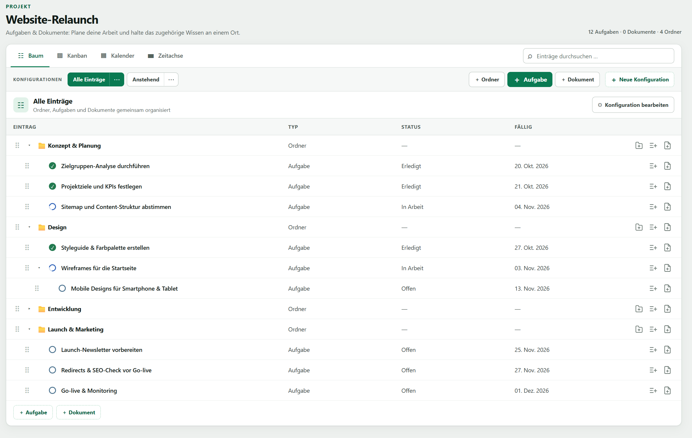
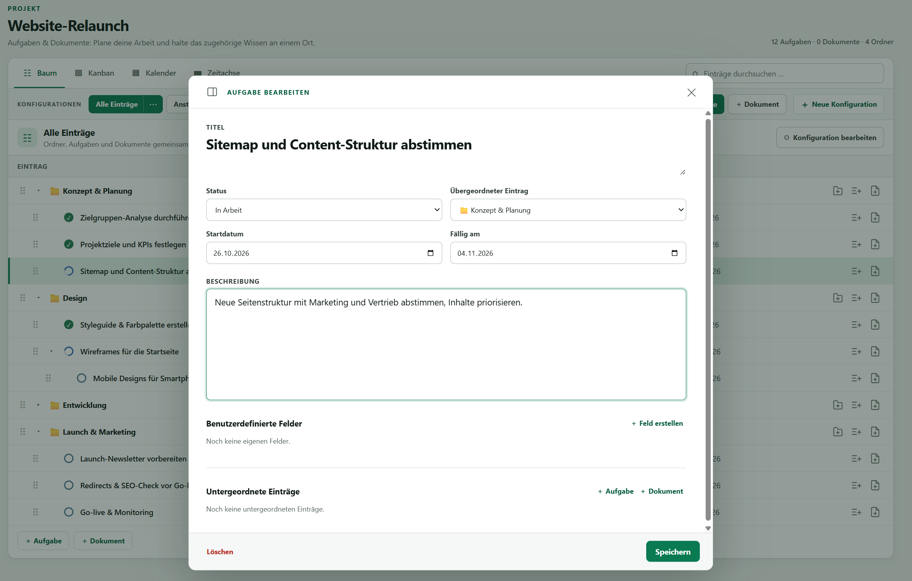
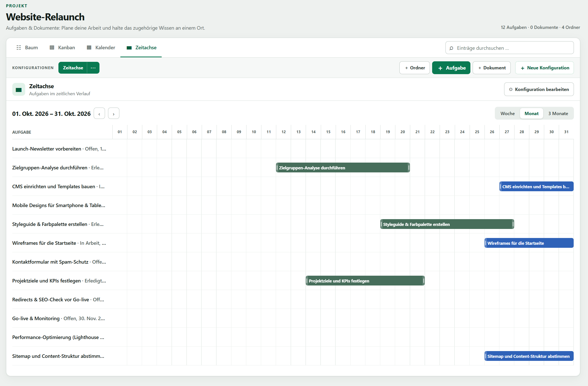

# Arbor – Tasks and Documents

Arbor is a local, single-user task and document manager. Plan your work as a tree of folders, tasks and documents, and keep the related knowledge in the same place. It is an ASP.NET Core MVC application (.NET 10) with Entity Framework Core and SQLite; the UI is hand-written vanilla JavaScript and CSS with no build step. There is no authentication, so it is meant to run on your own machine. The user interface is in German.



## Getting started

The only requirement is the .NET 10 SDK.

```powershell
dotnet run
```

Then open `http://localhost:5222`. On first start the app creates its database in `.local/arbor.db`, applies the migrations and seeds a first project with sample fields and views. Runtime data (database, uploaded images, storage settings) lives in `.local/`, which is git-ignored.

## Features

### Projects, folders, tasks and documents

- Work is organized in **projects**, which are strictly separated: each has its own statuses, custom fields and saved views.
- Inside a project, **folders, tasks and documents** share one tree. Tasks can have subtasks of any depth, and documents can sit under tasks (and vice versa). Items are reordered and re-parented with drag and drop.
- Tasks have a status, a start date, a due date and a rich-text description. Documents use the same editor. Folders only have a title and a description.
- **Custom fields** (text, number, date, select, yes/no) can be added to any item.
- Statuses are configurable (name, color) and belong to one of three categories: open, active or done.



### Views

Every project has saved view configurations, each with its own filters, visible fields, grouping and sorting:

- **Tree / table** – the whole hierarchy with inline editing, quick-create buttons and drag and drop.
- **Kanban** – one column per status; drag cards to change a task's status.
- **Calendar** – tasks by their dates.
- **Timeline** – a Gantt-style view (week, month or three months) where bars can be moved or resized to change the dates.

Filters can use relative dates such as "today" or "in 7 days", so a view like "Upcoming" stays current. Overdue tasks are highlighted. A global search covers titles, content and custom fields.



### Rich-text editor

Descriptions and documents use a [Tiptap](https://tiptap.dev) editor with headings, lists, checklists, tables, images and collapsible blocks. A `/` command menu inserts blocks, a formatting bar appears over selected text, and Markdown shortcuts work as well. Images can be pasted or dropped and are stored in the configured image folder. Checklist progress is shown on tasks in the views.

### Time tracking

The **Aufwände** page records working time in a weekly calendar (Monday to Friday by default). Click or drag to create an entry, drag to move or resize it, and see daily and weekly totals. Time entries are global across projects.

### Trash

Deleting an item moves it, with everything below it, to the trash. It can be undone right away or restored later from the trash page, which lists deleted items of all projects. Items can be deleted permanently or the whole trash emptied.

### Settings and storage

The settings page lets you move the database file and the image folder to another location; Arbor moves the existing data for you. The database is a single file, so a backup is just that file plus the image folder.

## Project structure

| Folder | Contents |
| --- | --- |
| `Domain` | Entities and business rules (`ItemKindRules` defines what folders, tasks and documents may have) |
| `Data` | EF Core `AppDbContext` and migrations |
| `Services` | All mutations, filtering and initialization |
| `Controllers` | Thin MVC and JSON endpoints that map routes to services |
| `Views` | Razor pages |
| `wwwroot/js`, `wwwroot/css` | The frontend, as plain ES modules and CSS |
| `wwwroot/lib/tiptap` | Prebuilt Tiptap bundle (source in `tools/tiptap`) |

Validation errors are returned as ProblemDetails (400 for rule violations, 404 for missing entities).

To create a new database migration:

```powershell
dotnet tool restore
dotnet ef migrations add <Name> --output-dir Data/Migrations
```

Updating the Tiptap bundle requires Node.js: edit `tools/tiptap/entry.js` or `package.json`, then run `npm install` and `npm run build` in `tools/tiptap`.
